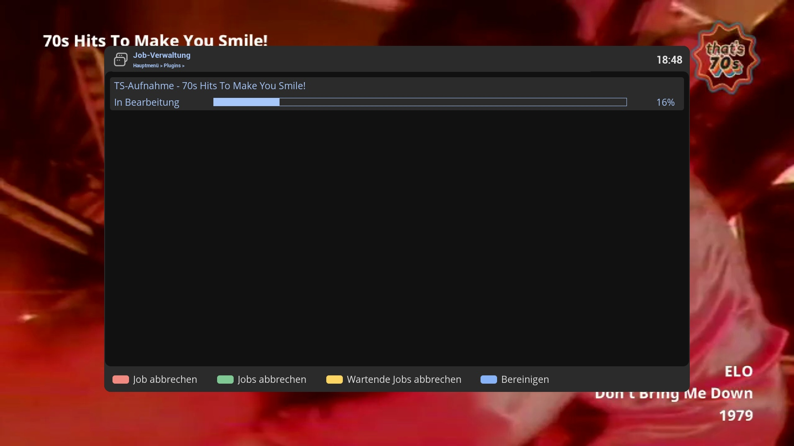

# JobCockpit (JOC)
Enigma2 plugin replacing standard job manager

## Features
- Keeps jobs after completion. 
- Adds functions to query successfully completed and failed jobs.
- Provides separate task managers by plugin that allows parallel execution of jobs.

## Documentation
Installation, usage and the interface for other plugins are described in the [JobCockpit wiki](https://github.com/OpenCockpit/JobCockpit/wiki).

## Limitations
- Tested on OpenViX and OpenATV with DM900.

## Installation
The plugin will be installed as a dependency, no explicit installation required.

## Wiki
- https://github.com/OpenCockpit/JobCockpit/wiki
